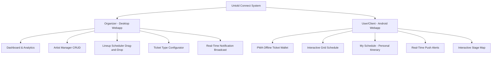

# Volume 2: Functional Specifications
## Feature Matrix, User Stories & Requirements

This document provides a highly detailed specification of all product features, interaction models, and requirements divided by user roles: **Organizer** and **User/Client**.

---

## 1. Feature Breakdown by User Role

---

## 2. Organizer Functionalities (Desktop Webapp)

The Organizer interface is a high-productivity administration dashboard optimized for mouse/keyboard navigation and widescreen displays.

### 2.1. Admin Authentication & Role Management
*   **Requirement:** Multi-factor authentication (MFA) for organizer accounts.
*   **Permissions:** Granular role-based access control (RBAC):
    *   *Super Admin:* Full system access.
    *   *Scheduler:* Edit artists and lineup.
    *   *Box Office Manager:* Edit ticket types and pricing.

### 2.2. Artist Manager (CRUD)
An admin-facing directory to manage all artists booked for UNTOLD.
*   **Data Fields:** Artist Name, Main Genre, Secondary Genre, Description/Bio, Spotify/Apple Music Embed URL, High-Resolution Press Kit Image, and Social Media links.
*   **Search & Tagging:** Dynamic search filter with automatic tagging (e.g., Techno, EDM, Trance, Hip-Hop).
*   **Quick Load:** Integration with Spotify API to auto-fill artist bios, genres, and profile images by entering their Spotify artist URL.

### 2.3. Chronological Lineup & Stage Scheduler
A visual matrix representing the festival stages (vertical columns) over time blocks (horizontal rows).
*   **Drag-and-Drop Editor:** Administrators can drag an artist block from a sidebar pool directly onto a stage timeline to create a "Set".
*   **Clash Prevention:** The system flags an error if:
    *   An artist is booked on two different stages at overlapping times.
    *   Two artists are scheduled on the same stage at the same time.
*   **Buffer Time Configurator:** Automatically adds a configurable "changeover" buffer (e.g., 15 minutes) between live sets.
*   **Instant Publishing:** Changes made to the draft schedule are not visible to users until clicked "Publish Changes," which triggers an automated diff calculation and syncs with client devices.

### 2.4. Ticket Type & Release Configurator
*   **Tier Management:** Create ticket tiers (e.g., "General Access - Phase 1", "GA Plus", "VIP Pass - 4 Days", "Thursday Day Pass").
*   **Pricing Engine:** Configure standard pricing, early bird discounts, and VAT values.
*   **Inventory Thresholds:** Set maximum ticket quantities per tier. Enable an automatic "Sold Out" state or transition to the next price phase once inventory is depleted.
*   **QR Generation:** Integrates with the ticketing engine to generate unique, cryptographically signed secure QR codes for buyers.

### 2.5. Broadcast Dispatch Center
*   **Global Broadcast:** Send emergency notifications or festival-wide updates (e.g., "Main Gates opening postponed to 14:00").
*   **Targeted Broadcast (Segmented):** Send alerts *only* to attendees who have "starred" a specific artist (e.g., "Martin Garrix set delayed by 20 minutes; new start time 01:15 at Mainstage").
*   **History Logs:** Track sent alerts, delivery rates, and user open rates.

---

## 3. User/Client Functionalities (Android Mobile Webapp)

The Client interface is designed as an **Android-optimized, mobile-first Progressive Web App (PWA)**, prioritizing speed, extreme thumb-reachability, and offline reliability.

### 3.1. Instant PWA Installation & Offline Shell
*   **App Shell:** Instant loading under 1.5 seconds on 3G networks using cached static resources.
*   **Offline Hydration:** Complete schedule, maps, and tickets are stored locally in the browser’s `IndexedDB` and remain fully usable even in "Airplane Mode".

### 3.2. Digital Ticket Wallet
*   **Secured Offline Access:** Shows bought tickets with QR codes. The QR codes are cryptographically signed JWT-like strings containing verification data, allowing scanners to validate tickets offline.
*   **Wristband Top-Up Portal:** Integrates with the physical RFID wristband system. Users can pre-register their ticket, associate it with their wristband, and securely add funds via Google Pay or Credit Card.
*   **Passbook Integration:** One-click option to add the ticket to Google Wallet (Android default).

### 3.3. Interactive Schedule & Lineup (Beach, Please! Style)
The central component of the app—an energetic, highly-designed chronological grid.
*   **Day Selector:** Sticky top horizontal slider (Day 1 - Thursday, Day 2 - Friday, Day 3 - Saturday, Day 4 - Sunday).
*   **Layout Modes:**
    1.  *Timeline View (Grid):* Horizontal scrolling stages, vertical scrolling hours. Feels like a live matrix.
    2.  *List View (Alphabetical / Chronological):* Simple scrollable feed filtered by Stage or Genre.
*   **Genre Tagging:** Dynamic badges matching genres. Clicking a badge isolates all matching sets.
*   **Live Status Indicator:** A blinking glowing red horizontal line traversing the schedule indicating the current time, with active stages highlighted in neon borders.

### 3.4. "My Schedule" (Personalized Itinerary & Clash Detector)
*   **One-Tap Star:** Users can "star" any artist card. This action adds the set to their personalized schedule.
*   **Clash Alerting:** If two starred artists have overlapping set times, a warning badge appears on the "My Schedule" screen (e.g., `"Clash: Armin van Buuren (Mainstage) overlaps with Tale Of Us (Galaxy) for 45 mins"`).
*   **Pre-Set Alerts:** Local background worker triggers an Android notification 15 minutes before a starred artist is scheduled to perform. **No internet connection is required for this alert to fire!**

### 3.5. Live Notification Feed
*   A dedicated notification hub showing a history of all system broadcasts and personal set alerts.
*   Read/Unread indicators, categorized by urgency: *High (Red/Emergency)*, *Update (Purple/Schedule Changes)*, *Promo (Gold/Partner Perks)*.

### 3.6. Interactive Vector Map
*   A highly performant canvas-based map of the Cluj Central Park and Cluj Arena.
*   **Live Pins:** Interactive markers for Stages, Food Trucks, Bars, Merch Shops, First Aid, and Water Points.
*   **Stage Card Expansion:** Tapping a stage marker on the map opens a sliding drawer from the bottom showing the currently performing artist and the next 3 scheduled sets.

---

## 4. User Journeys (Scenarios)

### User Story 1: Buying and Accessing a Ticket
1.  **Andrei** visits the Untold Connect webapp on his Android phone and navigates to **Tickets**.
2.  He buys a "VIP 4-Day Pass" using Google Pay.
3.  The app prompts him to add the webapp to his Android Home Screen (PWA Install). He accepts.
4.  The ticket, complete with a high-contrast QR code, instantly renders inside the **My Tickets** tab.
5.  A service worker caches the ticket data.
6.  At the festival gate, Andrei opens the app from his home screen. Even though there is zero cellular signal, his ticket loads instantly and is successfully scanned at the turnstile.

### User Story 2: Managing Lineup Changes (Organizer to Client)
1.  **Elena (Organizer)** gets word that *Steve Aoki's* flight is delayed. His set must shift from 22:00 to 23:30.
2.  She opens her **Desktop Dashboard**, navigates to the **Schedule Editor**, and drags Steve Aoki's block to 23:30.
3.  She clicks **Publish Changes**.
4.  The system automatically generates a targeted notification group consisting of all users who "starred" Steve Aoki.
5.  **Andrei** is walking around the festival. His phone vibrates: `"Schedule Alert: Steve Aoki's set has moved to 23:30 on the Mainstage."`
6.  Andrei opens his **My Schedule** view, which now automatically reflects the new slot and updates his clash indicators accordingly.
