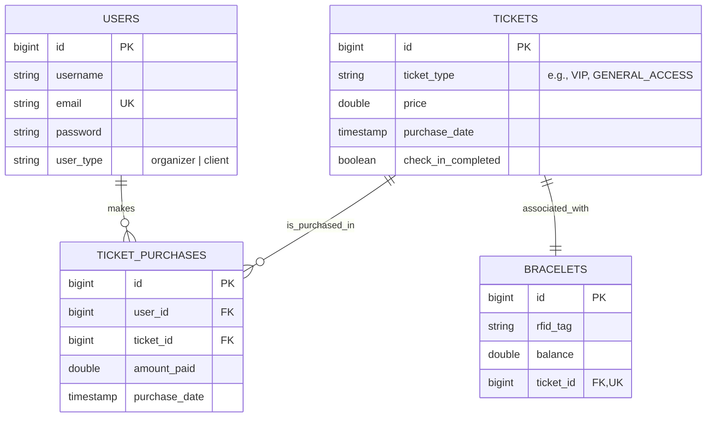

# Volume 3: Technical Architecture & System Design
## Tech Stack, Database Schema, API Design & Offline Sync

This document establishes the technical blueprint for the **Untold Connect** ecosystem. It is architected for maximum performance, security, and exceptional offline resilience on mobile devices.

---

## 1. Technical Stack

```
+--------------------------------------------------------------------------+
|                          CLIENT LAYERS (WEB PWAs)                        |
|                                                                          |
|   [Android Mobile PWA (Client)]            [Desktop Web Dashboard (Admin)]|
|   Vite + React + TypeScript + TailwindCSS   Vite + React + TS             |
|   Workbox (Service Worker, Caching)        Recharts (Analytics, Charts)   |
|   IndexedDB / Local Storage                                              |
+--------------------------------------------------------------------------+
                                     |
                                     v (REST APIs)
+--------------------------------------------------------------------------+
|                          GATEWAY & APPLICATION SERVER                    |
|                                                                          |
|   Backend Service: Java + Spring Boot + Spring Security                  |
|   Database Migration: Flyway                                             |
|   Payment Processor: Stripe API                                          |
+--------------------------------------------------------------------------+
                                     |
                                     v
+--------------------------------------------------------------------------+
|                          DATA & STORAGE PLATFORMS                        |
|                                                                          |
|   Primary Relational DB: PostgreSQL (Users, Tickets, Purchases, Bracelets)|
+--------------------------------------------------------------------------+
```

---

## 2. Database Schema (PostgreSQL)

Below is the relational database design supporting transactions, registration, ticketing, and RFID bracelet management.

> [!NOTE]
> **Lineup & Stage Schedules**: To optimize load times and ensure 100% offline access in crowded festival areas (like Cluj Arena), artist bios, stages, and set listings are managed client-side in the frontend via local mock databases, designed for high-fidelity interactive simulation.



### PostgreSQL DDL Definition (Flyway Migration Schema)
```sql
CREATE TABLE users (
    id BIGSERIAL PRIMARY KEY,
    username VARCHAR(255),
    email VARCHAR(255) UNIQUE,
    password VARCHAR(255),
    user_type VARCHAR(255)
);

CREATE TABLE tickets (
    id BIGSERIAL PRIMARY KEY,
    ticket_type VARCHAR(255),
    price DOUBLE PRECISION,
    purchase_date TIMESTAMP(6),
    check_in_completed BOOLEAN DEFAULT FALSE
);

CREATE TABLE ticket_purchases (
    id BIGSERIAL PRIMARY KEY,
    user_id BIGINT NOT NULL,
    ticket_id BIGINT NOT NULL,
    amount_paid DOUBLE PRECISION,
    purchase_date TIMESTAMP(6),
    CONSTRAINT fk_user FOREIGN KEY (user_id) REFERENCES users (id) ON DELETE CASCADE,
    CONSTRAINT fk_ticket FOREIGN KEY (ticket_id) REFERENCES tickets (id) ON DELETE CASCADE
);

CREATE TABLE bracelets (
    id BIGSERIAL PRIMARY KEY,
    rfid_tag VARCHAR(255),
    balance DOUBLE PRECISION DEFAULT 0.0,
    ticket_id BIGINT NOT NULL UNIQUE,
    CONSTRAINT fk_bracelet_ticket FOREIGN KEY (ticket_id) REFERENCES tickets (id) ON DELETE CASCADE
);
```

---

## 3. API Architecture (REST)

The application communicates over standard HTTP endpoints hosted by the Spring Boot backend service.

### 3.1. REST API Endpoints

#### Authentication & User Profiles (`AuthController` & `UserController`)
*   `POST /api/auth/register` - Registers a new user. Expects `username`, `email`, `password`, and `userType`. Returns JWT token and user info.
*   `POST /api/auth/login` - Authenticates user. Expects `email` and `password`. Returns JWT token and user details.
*   `GET /api/users` - [ADMIN] Lists all users.
*   `GET /api/users/{id}` - Retrieves a user by their ID.
*   `POST /api/users` - [ADMIN] Manually creates a user.
*   `PUT /api/users/{id}` - Updates user properties.
*   `DELETE /api/users/{id}` - [ADMIN] Deletes a user.

#### Ticketing Operations (`TicketController`)
*   `POST /api/tickets/buy` - Instantly purchases a single ticket. Expects `userId`, `ticketType`, and `price`.
*   `POST /api/tickets/bulk-buy` - Instantly purchases multiple tickets for a user.
*   `GET /api/tickets/user/{userId}` - Retrieves all tickets owned by a user, including connected wristbands.
*   `POST /api/tickets/{ticketId}/check-in` - Completes ticket gate check-in, setting `check_in_completed` to `true`.

#### Payment Integrations (`PaymentController`)
*   `POST /api/payment/create-checkout-session` - Contacts Stripe API to create an checkout session for a list of tickets. Returns the checkout URL.
*   `POST /api/payment/confirm` - Confirms a successful Stripe session by ID and issues the database ticket entities.
*   `POST /api/payment/webhook` - Stripe API webhook for production verification of completed checkouts.

> [!NOTE]
> **Lineup Updates & Notifications**: Real-time lineup modifications and push updates are simulated on the client side via state coordination, service worker notifications, and mock updates to avoid dependency on WebSocket server instances during offline periods.

---

## 4. Offline-First PWA Architecture

Since festival network infrastructure is highly unreliable, the Mobile Android PWA leverages a robust offline architecture.

```
       [ Android Mobile App / PWA Screen ]
                       ^
                       | (Data Binding)
          [ Local Database / LocalStorage ]
                       ^
         +-------------+-------------+
         | (Read operations)         | (Write actions)
         |                           v
[ Cache: Workbox SW ]       [ Offline Outbox Queue ]
  - Static Shell Assets       - Local storage bookmarks
  - Artist profile images     - Client notification sync
         ^                           |
         | (Network offline)         | (Background Sync)
         X                           v
     [ INTERNET ] <------------> [ API Server ]
```

### 4.1. Workbox Caching Strategy
*   **App Shell:** Cached using a **Cache-First** strategy. Includes `index.html`, compiled CSS/JS, and local assets (SVG maps).
*   **Artist Profile Images:** Cached using a **Cache-First / Stale-While-Revalidate** strategy, limiting the cache to 200 entries or 30 days to avoid clogging device storage.
*   **API Payloads:** Cached using a **Network-First** strategy. If the network is unavailable, the app falls back directly to the cached payload stored in local Storage.

### 4.2. Local Storage Partitioning
*   **LocalStorage / SessionStorage:**
    *   `starred_sets`: Cached array of artist/set IDs. Enables instant local-only bookmarks and schedule clashes calculations without making network requests.
    *   `auth_token`: JWT token returned by the Spring Boot backend.
    *   `user_details`: Cached user role and email for immediate UI rendering.

### 4.3. Pure Offline Schedule Alerts (No-Network Notifications)
*   **The Challenge:** Push notifications dispatched from servers require active cellular data.
*   **The Solution:** When Andrei stars an artist, the client application schedules a **Local Notification** inside the browser shell utilizing the HTML5 **Notification API** and **Service Worker registration.showNotification()**.
*   The worker reads the current local device clock and schedules a local wake-up alarm or handles background timers. This ensures notifications trigger even if the phone has zero bars of signal.

---

## 5. Security Architecture

### 5.1. Authentication
*   **JWT Authentication**: Implemented via a stateless Spring Security configuration.
*   The backend generates secure JSON Web Tokens using HS256 signatures, validated by `JwtAuthenticationFilter` on every HTTP request.
*   Role-Based Authorization ensures organizer dashboards are protected from client endpoints.

### 5.2. Payment Security
*   **Stripe Integration**: Checkout sessions are processed securely via the official Stripe API redirect. 
*   **Webhook Fulfillments**: Production ticket generation is triggered on Stripe webhook validation (`checkout.session.completed`) using signed signatures.
